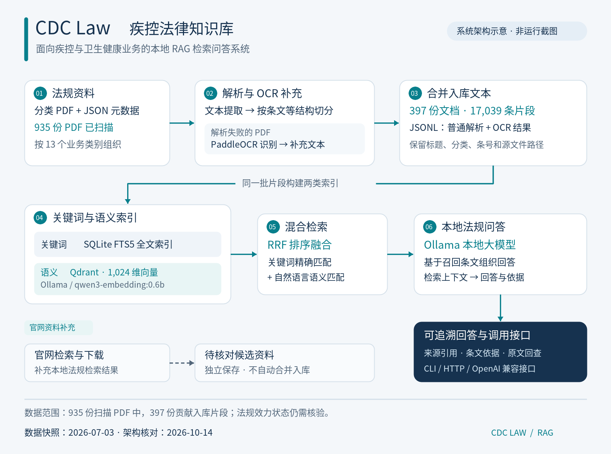

# CDC Law 疾控法律知识库

CDC Law 是一套面向疾控中心及卫生健康业务的本地法律法规检索增强生成（RAG）系统。它将分类保存的法规 PDF 和配套元数据转换为条文片段，结合关键词检索、语义检索与本地大模型，帮助使用者查找业务依据、阅读相关条文，并获得带来源引用的回答。

项目覆盖传染病防治、预防接种、职业卫生、公共卫生应急和卫生行政执法等场景，同时收录医疗机构、医疗服务和医务人员管理相关资料。资料包含国家层面及广东省、深圳市相关文件；实际覆盖范围以本地语料和索引为准。



*系统架构示意图；数据快照为 2026 年 7 月 3 日，文档与代码核对日期为 2026 年 10 月 14 日。[下载可编辑 SVG](docs/assets/cdc-law-architecture.svg)。*

## 主要能力

- **法规条文解析：**递归扫描分类目录，读取 PDF 和同名 JSON 元数据，识别章、节、条、款等结构。
- **扫描件 OCR 补充：**对解析报告中的失败 PDF 使用 PaddleOCR，保留识别缓存和人工复核文本，再合并文本片段。
- **双索引混合检索：**SQLite FTS5 提供关键词查询，Qdrant 提供语义查询，通过 RRF 排序融合检索结果。
- **有来源的本地问答：**调用 Ollama 模型，根据召回条文组织回答，提供片段标识、文件名称等引用信息，支持回查原文。
- **条件筛选与工具调用：**按业务分类、文件标题、法规状态、访问级别筛选；提供条文读取、类别列表和本地效力元数据查询。
- **联网资料补充：**本地问答入口支持官网检索兜底；联网增强入口支持 SearXNG 或 Tavily 搜索及网页正文提取。
- **多种调用方式：**提供命令行交互、HTTP API 和 OpenAI 兼容的聊天接口，方便接入后续业务应用。

## 数据规模与业务范围

以下数字来自本地解析报告、OCR 报告及 SQLite 实际查询，属于已有数据快照，不是克隆仓库后自动附带的数据。

| 指标 | 已核实数量 |
| --- | ---: |
| 原解析报告扫描的 PDF | 935 份 |
| 普通文本解析产生片段的文档 | 390 份 |
| OCR 补充文档 | 7 份 |
| 实际入库源文档 | 397 份 |
| 已入库文本片段 | 17,039 条 |
| 其中普通文本片段 | 16,371 条 |
| 其中 OCR 片段 | 668 条 |
| 一级业务类别 | 13 类 |
| 嵌入向量维度 | 1,024 维 |

各类已入库数量如下。文档数按数据库中不同的源文件路径统计，同一法规的不同文件不一定代表不同法规。

| 业务类别 | 入库文档数 | 文本片段数 |
| --- | ---: | ---: |
| 传染病防治 | 24 | 1,207 |
| 预防接种 | 4 | 222 |
| 职业病防治 | 7 | 430 |
| 公卫服务 | 5 | 130 |
| 应急处理 | 5 | 194 |
| 医疗废物 | 5 | 253 |
| 医疗机构 | 61 | 2,359 |
| 医疗服务 | 160 | 5,765 |
| 医务人员 | 24 | 868 |
| 医疗纠纷 | 21 | 909 |
| 法律基础 | 63 | 4,460 |
| 刑事（治安）责任 | 8 | 80 |
| 外国、台港澳从业者、陪护 | 10 | 162 |
| **合计** | **397** | **17,039** |

原扫描的 935 份 PDF 中，538 份尚未产生入库片段。解析报告的“成功”状态不等同于已形成可检索条文，后续需要继续核查零片段文件。

## 工作原理

资料处理首先从 PDF 中抽取文字并读取配套 JSON 信息，再按法规结构切分条文。失败文件进入 OCR 补充流程，最终生成 `chunks_merged_after_ocr.jsonl`。片段保留标题、分类、条号、源文件路径、日期、效力状态和页码等字段。

索引构建将同一批片段写入 SQLite 主表 `law_chunks`、全文索引 `law_chunks_fts` 和 Qdrant 集合 `law_chunks_local`。向量由 Ollama 的 `qwen3-embedding:0.6b` 模型生成。查询时，关键词和语义两路召回各自排序，再以 RRF 融合，最后从 SQLite 取回完整条文作为模型回答的依据。

官网补充检索与本地索引分开管理。下载的候选资料进入 `_rag_output/official_updates_pending/`，按 PDF、Word、HTML 和元数据分类保存，供后续核对；这些候选不会自动覆盖原文或更新现有索引。

## 源码结构

| 路径 | 用途 |
| --- | --- |
| [`scripts/01_build_chunks_recursive.py`](scripts/01_build_chunks_recursive.py) | PDF 文本提取、元数据读取、法规结构切分 |
| [`scripts/02_ocr_failed_pdfs.py`](scripts/02_ocr_failed_pdfs.py) | 失败 PDF 的 OCR 补充与片段合并 |
| [`scripts/03_build_indexes.py`](scripts/03_build_indexes.py) | SQLite 全文索引与 Qdrant 向量索引构建 |
| [`scripts/04_hybrid_search.py`](scripts/04_hybrid_search.py) | 混合检索、过滤、排序融合和查询报告 |
| [`scripts/06_law_chat_host.py`](scripts/06_law_chat_host.py) | 本地法规问答、工具调用、官网检索兜底 |
| [`scripts/07_law_web_research_host.py`](scripts/07_law_web_research_host.py) | 联网增强问答、网页提取和引用检查 |
| [`tests/`](tests/) | OCR、索引、混合检索及问答接口测试 |
| [`searxng/settings.example.yml`](searxng/settings.example.yml) | SearXNG 本地配置示例 |
| [`docs/assets/`](docs/assets/) | 文档配图，含 PNG 与 SVG |

脚本编号延续已有开发顺序，`06` 已实现自身所需工具，不要求存在 `05_agentic_rag.py`。本仓库保存介绍、架构图、核心流水线源码、测试和示例配置；原始语料、JSONL、SQLite、向量库、模型文件、运行日志及本机设置保留在本地。

## 安装与运行

需要 Python、支持 FTS5 的 SQLite、Ollama 和 Qdrant；OCR 与联网搜索组件按需配置。依赖文件记录了原开发环境中已安装的直接依赖版本，本次测试环境为 Python 3.13.13。它们不是包含全部间接依赖的锁文件。

在仓库根目录创建环境并安装基础依赖：

```bash
python -m venv .venv
source .venv/bin/activate
python -m pip install -r requirements.txt
```

需要处理扫描件时，另安装 `requirements-ocr.txt`；PaddlePaddle 的 CPU/GPU 构建需与设备匹配。执行测试时安装 `requirements-dev.txt`。

六个主要脚本默认使用仓库根目录作为项目根目录；可通过 `CDC_LAW_ROOT` 覆盖。该目录下需同时有 `scripts/`、分类资料目录及 `_rag_output/`，它不是仅指定外部数据目录的参数。

| 服务或配置 | 默认值 |
| --- | --- |
| Ollama | `http://localhost:11434` |
| Qdrant | `http://localhost:6333` |
| Qdrant 集合 | `law_chunks_local` |
| 嵌入模型 | `qwen3-embedding:0.6b` |
| 对话模型默认标签 | `qwen3.6:27b` |
| SearXNG | `http://127.0.0.1:8080` |
| 本地问答 HTTP 端口 | `8008` |
| 联网增强 HTTP 端口 | `8009` |

先使用 `ollama list` 检查本机模型。对话模型可以通过 `--llm-model` 指定已安装且支持所需工具调用的模型；默认标签不代表本机已经安装该模型。若使用 SearXNG，将示例配置复制为 `searxng/settings.yml` 并设置本地随机密钥。Tavily 为可选搜索提供方，通过环境变量 `TAVILY_API_KEY` 配置。

首次构建前，把法规 PDF 和同名 JSON 元数据放入相应分类目录，并启动 Ollama、Qdrant。以下命令会生成或更新本地解析结果和索引，应在确认资料目录后执行：

```bash
python scripts/01_build_chunks_recursive.py
python scripts/02_ocr_failed_pdfs.py
python scripts/03_build_indexes.py
```

已有索引时可直接查询。例如，查询“传染病疫情报告有哪些职责要求”：

```bash
python scripts/04_hybrid_search.py --query "传染病疫情报告有哪些职责要求" --top-k 5
python scripts/06_law_chat_host.py --interactive --llm-model "你的已安装模型标签"
```

该示例展示查询方式，不预设具体法律结论。使用者应查看召回条文、文件名称与版本，再回查原文件。

启动 HTTP 服务：

```bash
python scripts/06_law_chat_host.py --serve --llm-model "你的已安装模型标签"
python scripts/07_law_web_research_host.py --serve --llm-model "你的已安装模型标签" --web-provider searxng
```

两个入口均支持 `/health`、`/tools`、`/chat` 和 `/v1/chat/completions`。默认绑定 `127.0.0.1`；接口应在完成本地依赖、模型及索引检查后使用。

测试命令：

2026 年 10 月 14 日，本机现有 57 项测试全部通过；另一次禁止真实网络连接的验证同样通过，且没有触发联网尝试。这些测试验证代码行为，不代表法规内容已完成效力审查或全部服务已部署。

```bash
python -m pip install -r requirements-dev.txt
python -m pytest -q tests
```

## 当前边界与后续完善

本地快照中所有片段的效力状态均为“未知”。`check_validity` 查询的是已有状态及日期字段，不能代替现行有效性核验；官网候选日期比较也不等于法规版本的精确匹配。

页码字段已经保存，但现有快照存在结束页小于起始页的异常，引用时应结合文件名称、条号和原 PDF 检查。零片段文件、OCR 识别质量、重复版本和效力元数据是后续数据治理的重点。

原机器上曾构建 Qdrant 集合并记录 17,039 个向量点。2026 年 10 月 12 日检查时，容器 `law-qdrant` 已停止，数据保存在容器内 `/qdrant/storage/collections/law_chunks_local`，没有宿主目录挂载。这是原环境的历史状态；新环境需要准备自己的向量存储，迁移时应一并保存索引、模型配置及源文件映射。

后续开发可优先补齐未入库资料、修复页码与版本元数据、加入检索质量评估，再完善部署配置和业务界面。
